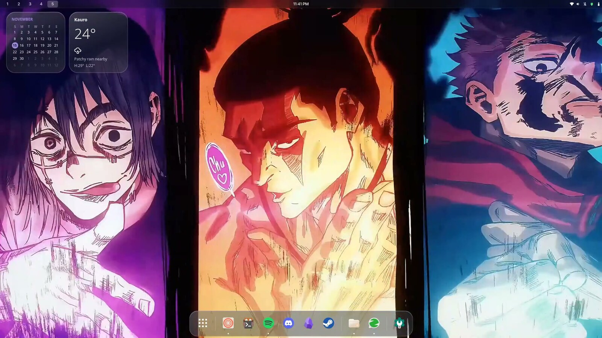
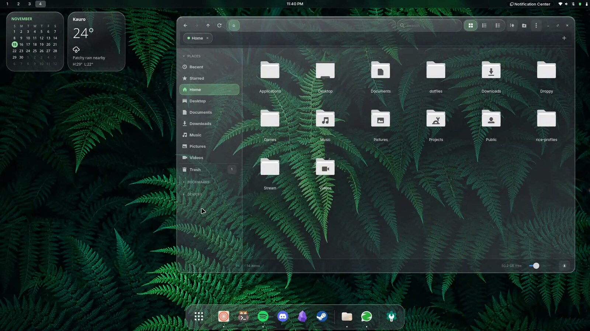
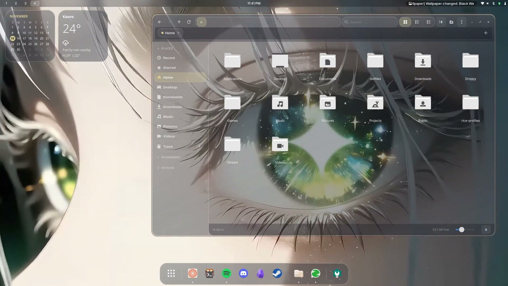
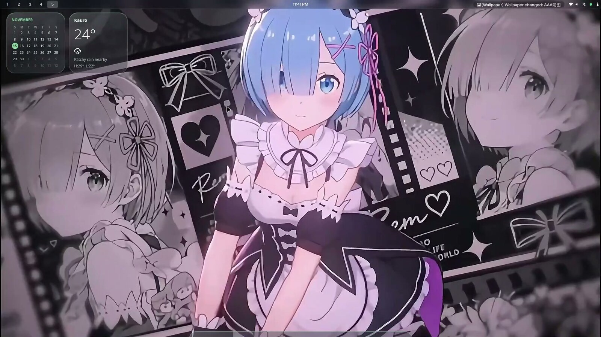

# Glasswing

**A complete glass Hyprland shell for Arch Linux.**

Glasswing is a full desktop, not a dotfiles dump: a frosted top bar, a
wallpaper-tinted dock, desktop widgets, a notification center, floating
popouts, a GTK4 file manager, and a wallpaper-driven colour pipeline. It is
designed to be cloned, installed, and lived in.

The name comes from the glasswing butterfly — transparent wings, a quiet
outline, and just enough colour to catch the light.



<p align="center">
  <a href="media/demo.mp4"><strong>▶ Watch the 75-second demo</strong></a>
</p>

## What you get

| Piece | What it does |
| --- | --- |
| **Top bar** | Waybar with workspaces, a live clock, a dynamic status pill, network, volume, Bluetooth, battery, and temperature. Click the pill for notifications; right-click for the volume popup. |
| **Dock** | An auto-hiding glass dock pinned to installed apps, with running indicators and a glass hover card. |
| **Desktop widgets** | Weather, calendar, now-playing, system stats, and a photo card, all layered directly on the wallpaper. |
| **Popouts** | GTK4 layer-shell panels for Wi-Fi, Bluetooth, volume, battery, calendar, clipboard, notes, and settings. |
| **Glass Files** | A single-instance GTK4 file manager with tabs, split view, Quick Look, image rotation, batch rename, archive tools, trash, undo/redo, and `org.freedesktop.FileManager1`. |
| **Wallpaper pipeline** | Waypaper + mpvpaper for images and video; Wallust recolours Kitty, Waybar, Rofi, SwayNC, Wlogout, Hyprland, and Cava. |
| **Settings** | A glass settings popout with live lock-screen previews, video wallpaper thumbnails, RAM and storage pie charts, and controls for accent colour, top bar, dock, widgets, wallpaper, SDDM login screen, session lock screen, and app management. |
| **Session pieces** | Hyprlock session lock screen with configurable wallpaper, blur, card, clock, and password field; Hypridle, cliphist clipboard history, screenshot/recording shortcuts, and a wlogout session menu. |

## Screenshots

| Desktop | Glass Files | Popouts |
| --- | --- | --- |
|  |  |  |

More media will be added as the shell is polished. The compressed demo lives at
[`media/demo.mp4`](media/demo.mp4); the original 1080p60 recording is attached
to the first GitHub release.

## Requirements

- Arch Linux (or an Arch-derived distro with `pacman`)
- Hyprland 0.56+ with Lua configuration support
- Wayland session; a GPU with Hyprland blur support
- AUR helper (`yay` or `paru`) for `wallust`, `waypaper`, `wlogout`,
  `mpvpaper`, `wl-screenrec`, HyprMod, and the Bibata cursor theme
- GTK4, PyGObject, Gtk4LayerShell, Python Pillow
- NetworkManager and BlueZ for the network/Bluetooth popouts
- PipeWire/WirePlumber for the volume OSD (recommended; detected, not forced)

The installer handles the package list, including the AUR packages when a
helper is available. It does **not** enable system services or replace your
audio stack. Enable `NetworkManager`, `bluetooth`, and `upower` as usual for
your system.

## Install

```bash
git clone https://github.com/alliseeislight/glasswing.git
cd glasswing
./install.sh
```

The installer:

- checks the runtime (GTK4, PyGObject, Gtk4LayerShell, Hyprland)
- installs missing repo packages with `pacman` and AUR packages with
  `yay`/`paru` (skip with `--no-deps`)
- backs up every file it replaces under
  `~/.local/state/glasswing/backups/<timestamp>/`
- installs configs to `~/.config/{hypr,waybar,swaync,rofi,kitty,wallust,waypaper,wlogout}`
- installs Glass Files to `~/.local/share/glasswing/glass-files`
- installs launchers to `~/.local/bin`
- writes the desktop entry, icon, and D-Bus services
- registers Glass Files for `inode/directory` and
  `org.freedesktop.FileManager1` (skip with `--no-file-manager`)
- keeps Swappy as the default image viewer for common image formats
- installs a sample wallpaper and photo-card image only when those files do not
  already exist
- reloads Hyprland when run inside the same user session

Useful flags:

```bash
./install.sh --dry-run          # show the plan, change nothing
./install.sh --no-deps          # do not install packages
./install.sh --no-file-manager  # keep your current default file manager
./install.sh --yes              # non-interactive
./install.sh --no-reload        # do not reload the running session
```

Then log out and back in. Glasswing starts with Hyprland; nothing needs a
systemd user service.

## First run

- `Super + E` opens Glass Files.
- `Super + D` opens the launcher.
- `Super + W` cycles wallpapers.
- Click the clock for the calendar, the dynamic pill for notifications, and the
  volume module for the volume popup.
- Open the settings popout with `Super + I` to tune the accent, bar, dock,
  widgets, and wallpaper. The **Login screen** page changes the active SDDM
  theme's wallpaper and, when the theme exposes them, its blur, dimming, clock,
  and date format. The **Screen lock** page controls the Hyprlock session lock
  screen: wallpaper, blur and dimming, card size and opacity, 12/24-hour clock,
  date format, username, and password-field styling. Both pages have a small
  live preview that updates as you change the settings. The **Wallpaper & theme**
  grid shows real thumbnails for video wallpapers too. The **System** page has
  live RAM and storage pie charts with swap, capacity, load, uptime, and process
  counts alongside them.

The sample wallpaper is installed to `~/Pictures/wallpapers/glasswing.jpg`.
Drop more images or videos into that folder; Waypaper and `Super + W` use it as
the wallpaper source.

## Keybinds

| Keys | Action |
| --- | --- |
| `Super + Return` | toggle floating for the active window |
| `Super + T` | terminal (Kitty) |
| `Super + B` | open the Glasswing repository in the browser |
| `Super + E` | Glass Files |
| `Super + D` | application launcher (Rofi) |
| `Super + W` | next wallpaper |
| `Super + Q` / `Super + Shift + Q` | close window / kill process |
| `Super + F` / `Super + Shift + F` | fullscreen / fullscreen with decorations |
| `Super + P` | pin window |
| `Super + arrows` | focus window |
| `Super + Shift + arrows` | resize column |
| `Super + 1…0` | switch workspace |
| `Super + Shift + 1…0` | move window to workspace |
| `Super + S` / `Super + Shift + S` | scratchpad / move to scratchpad |
| `Super + V` / `Super + Shift + N` | clipboard / notes |
| `Super + I` | settings popout |
| `Super + N` | notification center |
| `Print` / `Shift + Print` | full / region screenshot |
| `Super + Print` | region screenshot with Satty annotation |
| `Super + R` | start/stop screen recording |
| `Alt + F7` | session menu (wlogout) |
| `Super + Ctrl + R` | reload Hyprland |

Screenshots go to `~/Pictures/Screenshots`; recordings go to
`~/Videos/Recordings`.

## Configuration

| Path | Purpose |
| --- | --- |
| `~/.config/hypr/` | Hyprland Lua config, scripts, popouts, lock screen, idle |
| `~/.config/waybar/` | top bar |
| `~/.config/swaync/` | notification center |
| `~/.config/rofi/` | launcher |
| `~/.config/kitty/` | terminal |
| `~/.config/wallust/` | wallpaper colour templates and targets |
| `~/.config/waypaper/` | wallpaper backend and folder |
| `~/.config/wlogout/` | session menu |
| `~/.config/glass/` | shell settings, file-manager prefs, lock-screen prefs, accent, user Hyprland overrides |
| `~/.local/share/glasswing/glass-files/` | Glass Files source |
| `~/.local/state/glasswing/` | install backups and manifests |

Wallust writes the generated palettes into the config trees. If you edit a
generated `colors.*` file, the next wallpaper change will replace it; edit the
Wallust templates instead.

The settings app writes `~/.config/glass/hypr-user.lua`, which is loaded after
the main Hyprland config. That is the right place for per-machine overrides
(monitor layout, keyboard layout, touchpad, and so on).

## Glass Files

Glass Files is single-instance, remembers per-folder view/sort state, and
implements `org.freedesktop.FileManager1`. A second launch forwards paths to
the running window as tabs. See [`glass-files/README.md`](glass-files/README.md)
for the full feature list and keyboard reference.

## Uninstall

```bash
./uninstall.sh                  # remove app + desktop integration, keep configs
./uninstall.sh --restore        # restore the files backed up by the last install
./uninstall.sh --purge          # remove app + installed config trees
```

`--restore` uses the manifest written by the installer, so a fresh install can
be rolled back to the exact previous configuration (including symlinks).

## Repository layout

```
install.sh                 installer
uninstall.sh               safe rollback / removal
config/                    Hyprland, Waybar, SwayNC, Rofi, Kitty, Wallust, Waypaper, Wlogout
glass-files/               GTK4 file manager source and D-Bus/desktop templates
scripts/                   launchers for screenshots, recording, bar startup
assets/wallpapers/         generated Glasswing wallpaper
assets/widgets/            sample photo-card image
media/                      compressed demo and screenshots
```

## Notes

- The shell targets Arch Linux and Hyprland's Lua configuration. It will not
  work as-is on a non-Arch distro or on a Hyprland build without Lua support.
- The installer never runs `sudo` for user files. `sudo` is only used for
  `pacman` when you approve package installation.
- Glass Files replaces the `org.freedesktop.FileManager1` service by default so
  “Show in folder” works. Use `--no-file-manager` to keep your current handler.
- The SDDM blur step is optional and only runs if the theme file is writable by
  your user. Set `GLASSWING_SDDM_WALLPAPER` to point at a different theme file.
- The **Login screen** page writes only to the active SDDM theme's
  `theme.conf` and wallpaper cache; it does not edit `/etc/sddm.conf`. The
  active theme directory and cache must be writable by your user.

## Credits

Built as a personal Arch/Hyprland shell and packaged for anyone who wants the
same glass. It leans on Hyprland, Waybar, SwayNC, Rofi, Kitty, Wallust,
Waypaper, mpvpaper, wlogout, GTK4, and a long list of small Wayland utilities.
Glass Files is part of this repository.

## License

MIT. See [LICENSE](LICENSE).
